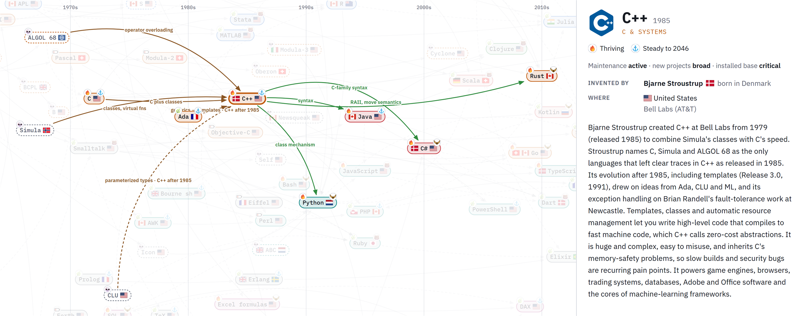

# Programming Language Lineage

No programming language starts from nothing. Python took its indentation-based blocks from ABC, R its closures and lexical scoping from Scheme, and JavaScript its prototype-based objects from Self. This project traces those borrowings as an interactive directed graph on a timeline: 88 languages as nodes, from Fortran (1957) to Zig (2016), and 147 documented influences as arrows between them. It is written for data scientists, so it includes the statistics, data and BI languages that general histories often skip.

**[Open the map](https://nomoteticus.github.io/programming-language-lineage/)** · [Data](data/) · [Method note](docs/method.md)

[](https://nomoteticus.github.io/programming-language-lineage/)

**Preview:** *C++ selected, with what shaped it (brown), what it went on to shape (green), and the top of its card.*

You can use it to:

- **Look up one language:** who made it and where, what influenced it, how widely it is used and for what, and where it may be heading.
- **See how languages shaped each other:** follow an idea from the language that introduced it to the ones that took it up.
- **Analyze the network:** the links are published as data, so you can measure which languages are most central, how far each one's influence reaches, and which ones connect otherwise separate families.

## Features

- **A directed graph on a timeline.** The horizontal axis is time: each language sits at the year it was first announced or released. The vertical position carries no value; it is chosen for readability, with related languages near each other. Counting only influences on a language's original design, the graph is acyclic (a DAG); the later-version links add one cycle, between PHP and Hack.
- **Nine families.** Each language is colored by its family: Lisp, ML & Haskell, Arrays & statistics, C & systems, JVM & .NET, Scripting & web, Data & BI, Teaching & visual, or Other lineages.
- **Labeled influences.** An arrow runs from a language to one it influenced and says what was passed on, for example *C plus classes* from C to C++. A solid line is a strong influence and a dotted line a weaker or partial one. Where the influence arrived in a later version of the language, the label carries that version, for example *generators · Python 2.2*.
- **Direct and indirect influence.** Click or hover a language to highlight what shaped it (ancestors, in brown) and what it went on to shape (successors, in green). For each direction you choose how far to follow the chain: none, direct, second degree, or all.
- **Two flags per language.** The right flag shows where the language was built; the left flag shows where its designer was born, when that differs. Hover a flag for the designers' names.
- **Health today.** A badge rates each language as 🔥 Thriving, 🌿 Alive, 🪫 Fading or 💀 Dead. It is derived from three dimensions shown on the card: maintenance, new projects and installed base.
- **Outlook to 2046.** Languages that are Alive or Thriving also get an outlook for their share of newly written code by 2046: 🐂 Bullish, ⚓ Steady or 🐻 Bearish. Each outlook comes with a reason, a confidence level and a condition that would change it.
- **A card for every language.** It gives the designers, the organization, a short history, the health and outlook reasoning, the direct influences in both directions with a link to the source for each, and famous software written in the language.
- **Filters and selection.** Click a family, health or outlook category to pick out its languages, and combine categories to narrow down. Ctrl-click (⌘-click on a Mac) selects several languages at once, and the card can be hidden to see the whole map.
- **Open data.** The languages, the links and the evidence for every link are published as CSV files in [`data/`](data/).

The [method note](docs/method.md) gives the full design: what counts as a node and a link, the health and outlook rules, the limitations, and the complete link table with sources.

## Background and disclosure

I am a data scientist, not a programming-language historian. When I started I knew fewer than half of these languages and had used fewer than 20 of them. This is a learning project. Every link cites a source (137 of 147 are primary: designers' papers, ACM HOPL histories, official FAQs and documentation), so you don't have to take my word, or an AI's, for any of it. The health and outlook badges are AI judgments, not measurements: Claude proposed them, the two AI reviewers challenged them, and I decided the disputed ones. Each comes with a one-line reason and, for outlooks, a confidence level and a condition that would change it.

## How it was made

I was studying PySpark with Claude, and a snippet looked strange to me as an R and Python user, so I asked why. The answer was that PySpark wraps an engine written in Scala, which runs on the Java Virtual Machine, like Java and Kotlin. So I announced "Rabbithole incoming", asked to hear more about Kotlin, and down I went: Lisp, ML and Haskell, Rust and Go, whether Julia ever took off. On the way down, Claude wrote the same small program in about twenty languages so I could compare them. At the bottom I wanted a picture of where I had been:

> To finish this off, can you draw me a pretty graph containing all these languages we mentioned (and maybe JavaScript too) with arrows meaning influence and adding what the influence is on the arrows?

From there I directed and Claude (Anthropic) built. I asked for each feature in turn: coverage of all major programming languages, flags for where a language was built and where its designers were born, health and outlook badges, cards with sources, filters, and pruning of minor influences. That became version 1: 82 languages and 129 links.

I then had it reviewed by two other AI models, **Gemini 3.1 Pro** and **ChatGPT 6.1 Sol**, acting as adversarial reviewers over three rounds. I decided each point, conceding or arguing on the merits, and afterwards made a further revision of my own. The result is version 2, the version shown here. Three models checked each other, and a human decided.

Version 1 is kept in this repository under the tag [`v1-pre-review`](https://github.com/nomoteticus/programming-language-lineage/tree/v1-pre-review).

## Data and method

| File | What it is |
|---|---|
| [`site/index.html`](site/index.html) | The map, as one stand-alone page. It also works offline, except for the web fonts. |
| [`data/nodes.csv`](data/nodes.csv) | One row per language: year, family, country, designers, health, outlook, description. |
| [`data/edges.csv`](data/edges.csv) | One row per link: label, strength, kind, later-version tag, and the evidence record. |
| [`data/edges-v1-to-v2.csv`](data/edges-v1-to-v2.csv) | What changed in the links between version 1 and version 2. |
| [`data/languages-v1-to-v2.csv`](data/languages-v1-to-v2.csv) | The languages added, removed, renamed or re-dated between version 1 and version 2. |
| [`docs/method.md`](docs/method.md) | The method note: what a node and a link are, the health and outlook rules, limitations, and the full link table with sources. |
| [`docs/logo-credits.md`](docs/logo-credits.md) | Credits and notices for the language logos. |
| [`source/`](source/) | The generator scripts and their inputs. |

A missing link means the influence was not documented in the sources I checked, not that there was none. The method note lists the other limitations.

## What changed after AI review

| | Version 1 | Version 2 |
|---|---|---|
| Languages | 82 | 88 |
| Links | 129 | 147 |
| Strong / weak links | 110 / 19 | 104 / 43 |

- **Languages.** Ten were added (CPL, ALGOL 68, ISWIM, B, Common Lisp, Cyclone, Newsqueak, J, K/q, VBA) and four removed as scope choices (CoffeeScript, KQL, LookML, Mojo).
- **Sources.** Every link now has an evidence record: citation, URL, supporting quote, and a verdict. Many labels were rewritten to say what the source documents; of the 115 links present in both versions, 66 have a new label.
- **Strength.** Links were reconsidered in both directions. Of those 115 links, 18 went from strong to weak (for example COBOL → ABAP and Ruby → Elixir) and one from weak to strong.
- **Later features.** 16 links carry the version in which the influence arrived (for example *ES2015*, *Python 2.2*, *PHP 7.1*), so they can be told apart from a language's original design.
- **Node rule.** Each node is a historical language, a continuing language, or a deliberately aggregated node, with 16 scope exceptions listed (for example, Smalltalk covers Smalltalk-80, Squeak and Pharo).
- **Health.** It is judged on three dimensions (maintenance, new projects, installed base) and the badge is derived from them. "Dying" was renamed "Fading".
- **Outlook.** Each outlook has a confidence level and a "would change if" condition, and the ones that rest mainly on the assumption that AI writes more code are marked low confidence. Several calls changed: DAX, Swift, Lua and Cypher moved from Bullish to Steady, Julia and Scratch from Bearish to Steady, and Clojure and Smalltalk from Dying to Alive with a Bearish outlook.

[`data/edges-v1-to-v2.csv`](data/edges-v1-to-v2.csv) lists every link of either version with its version 1 and version 2 values side by side, and [`data/languages-v1-to-v2.csv`](data/languages-v1-to-v2.csv) lists the languages added, removed or renamed. Both include my own revision after the review, not only the changes the reviewers asked for.

## Credits

**Related work**

- Éric Lévénez, [*Computer Languages History*](https://www.levenez.com/lang/), a timeline chart of languages and their versions.
- O'Reilly, [*History of Programming Languages*](https://www.cs.toronto.edu/~gpenn/csc324/PLhistory.pdf) poster (2004; copy hosted by the University of Toronto).
- Ramiro Gómez, [*Programming Languages Influence Network*](https://exploring-data.com/vis/programming-languages-influence-network/), an interactive influence network.
- Peter Gleeson, [*How to visualize the programming language influence graph*](https://www.freecodecamp.org/news/how-to-visualize-the-programming-language-influence-graph-7f1b765b44d1/) (freeCodeCamp, 2017).
- The ACM [History of Programming Languages (HOPL)](https://dl.acm.org/conference/hopl/proceedings) conference papers, which 27 of the 147 links cite.

**Assets and tools**

- **Flags:** [flag-icons](https://github.com/lipis/flag-icons) (MIT).
- **Logos:** [Simple Icons](https://simpleicons.org/) (CC0 icon data). The marks belong to their owners and are used only to identify each language; see the [logo credits](docs/logo-credits.md).
- **Fonts:** [IBM Plex](https://github.com/IBM/plex) (SIL Open Font License).
- **Built with** Claude (Anthropic).
- **Reviewed by** Gemini 3.1 Pro and ChatGPT 6.1 Sol.

## Rebuilding

This section is a guide to changing the map and regenerating everything that depends on it. The page, the method note and the CSV files are not written by hand: they are all generated from a few files in [`source/`](source/), so the map, the documentation and the data cannot drift apart.

| To change | Edit |
|---|---|
| A link, its label or its strength | `edges.py` |
| A language, its health or its outlook | `make_nodes.py` |
| The text on a card | `make_desc.py` |
| The evidence for a link | `make_sources.py` (or a file in `research/`) |
| The page layout and behavior | `template.html` |

Then regenerate. The data files and the method note need only Python 3 (standard library). From `source/`:

```bash
python -X utf8 make_nodes.py      # languages          -> nodes.py
python -X utf8 make_desc.py       # card text          -> desc.py
python -X utf8 make_sources.py    # evidence records   -> sources.json
python -X utf8 make_method.py     # method note        -> ../docs/method.md
python -X utf8 export_data.py     # data files         -> ../data/nodes.csv, ../data/edges.csv
python -X utf8 compare_v1_v2.py   # change tables      -> ../data/edges-v1-to-v2.csv, ../data/languages-v1-to-v2.csv
```

The `-X utf8` flag matters on Windows. Regenerating the page itself also needs the flag and logo image packages, at pinned versions so the result is reproducible:

```bash
npm pack flag-icons@7.5.0 && tar xzf flag-icons-7.5.0.tgz
npm pack simple-icons@16.34.0 && mkdir -p si && tar xzf simple-icons-16.34.0.tgz -C si
python -X utf8 build.py           # the page           -> ../site/index.html
```

`build.py` also prints layout warnings (`NODE OVERLAP`, `EDGE HITS NODE`, `LABEL CLASH`); about fifty minor ones are normal.

## License

Code is under the [MIT license](LICENSE). The data, the method note and the text on the cards are under [CC BY 4.0](LICENSE-data).
